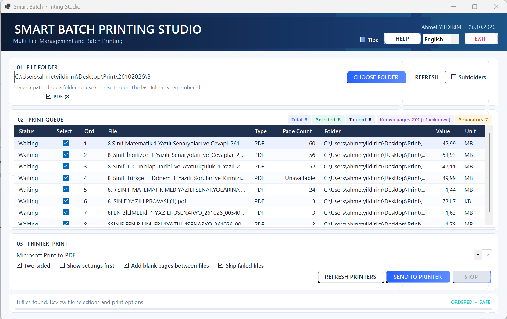

<div align="center">

# Smart Batch Printing Studio (SBPS)

### Multi-Format Batch Printing Software for Windows

**Organize, filter, and batch-print multiple file types through a controlled Windows print queue.**

Built with **C# · .NET 9 · Windows Forms · Microsoft Edge WebView2**

[**Türkçe**](README.tr.md) · [**Installation**](docs/INSTALLATION.md) · [**User Guide**](docs/USER_GUIDE.md) · [**Troubleshooting**](docs/TROUBLESHOOTING.md)



</div>

---

## Overview

**Smart Batch Printing Studio (SBPS)** is a Windows desktop application developed with **C#, .NET 9, Windows Forms, and Microsoft Edge WebView2** for organizing, filtering, and batch-printing multiple file types through a controlled print queue.

The application transforms a folder containing different supported file formats into an organized printing workflow.

Instead of opening files individually, users can select a folder, filter available file types, include or exclude individual files, choose an installed Windows printer, review available page-count information, and submit the selected files in file-name order.

SBPS supports PDF documents, images, text files, and web documents as part of its multi-format printing workflow.

Each source file is processed as a **separate print job**. Optional blank separator pages can be inserted between consecutive files.

The application is designed for Windows users and operators who need a repeatable and manageable solution for printing multiple files.

### Primary Use Cases

- Multi-format batch printing
- Windows desktop printing
- Printing multiple files from a folder
- Folder-based document printing
- Mixed-file printing workflows
- Print queue preparation and management
- Document selection and filtering
- Printing with optional blank separator pages
- Controlled and cancellable print processing

Actual output depends on Windows, the selected printer, its driver, and the supported rendering capabilities.

---

## Key Features

### Folder and File Management

- Manual folder-path entry
- Windows folder selection dialog
- Drag-and-drop folder selection
- Optional recursive subfolder scanning
- Automatic detection of supported file extensions
- Dynamic file-type filters generated from folder contents
- Individual file selection and exclusion
- File processing in file-name order
- Supported and unsupported file statistics

### Print Queue Management

- Real-time total file count
- Selected file count
- Printable file count
- Individual file printing status
- Ordered print job submission
- Cancellable queue processing
- Diagnostic logging
- Configurable failure handling

### Page Count Information

- Best-effort PDF page-count detection
- One-page representation for supported image formats
- Page-count information without starting a print job
- Known content-page totals
- Planned blank separator-page totals
- Clear indication when page counts are unavailable

Page-count information does not guarantee the number of physical sheets produced by a printer.

### Printer Configuration

- Automatic detection of installed Windows printers
- Manual printer selection
- Printer-list refresh
- Duplex printing enabled by default when supported
- Optional Windows printer settings dialog
- Configurable blank separator pages
- Printer and driver capability awareness

### Error Handling and Cancellation

- Per-file status tracking
- Diagnostic error logging
- Queue cancellation
- Configurable error handling
- **Skip failed files** enabled by default
- Option to stop submitting remaining files after a failure

When **Skip failed files** is enabled, a failed file does not automatically stop the remaining queue.

When disabled, a failure prevents further files from being submitted.

### User Interface

- Windows Forms desktop interface
- High-DPI-aware layout
- Turkish and English language support
- Initial language selection from Windows regional settings
- Runtime language switching
- Optional contextual tips
- Sectioned in-application help
- Dedicated Exit button
- Confirmation before closing during active printing

The **Tips** option is disabled by default. Tips remain hidden until explicitly enabled.

---

## Supported File Formats

Smart Batch Printing Studio supports multiple file categories in its current printing workflow.

| Category | Supported Extensions | Page Count |
|---|---|---|
| PDF documents | `.pdf` | Detected when safely available |
| Images | `.jpg`, `.jpeg`, `.jfif`, `.png`, `.bmp`, `.gif`, `.webp`, `.svg`, `.avif`, `.ico`, `.jxl` | 1 page |
| Text documents | `.txt`, `.csv`, `.xml` | Determined during printing |
| Web documents | `.html`, `.htm`, `.xhtml`, `.mht`, `.mhtml` | Determined during printing |

### Important Notes

- PDF page counts may be unavailable for encrypted, damaged, unusually encoded, or very large files.
- Supported images follow the application's current one-page printing workflow.
- Text and web document pagination depends on the rendering engine and printer configuration.
- Microsoft Word `.docx` and Microsoft Excel `.xlsx` files are **not natively supported**.

**SBPS is a multi-format batch printing application, not a PDF-only printing tool.**

---

## Screenshots

### Main Application Window


---

## Getting Started

### System Requirements

| Component | Requirement |
|---|---|
| Operating System | Windows 10 or Windows 11 |
| Development Framework | .NET 9 |
| Programming Language | C# |
| Desktop UI | Windows Forms |
| Rendering | Microsoft Edge WebView2 Runtime |
| Development IDE | Visual Studio 2022 17.12 or later |
| Alternative Development | .NET CLI |
| Printing | At least one installed Windows printer |

For development, install the **.NET desktop development** workload in Visual Studio or use the .NET SDK directly.

### Clone the Repository

```powershell
git clone https://github.com/AhmetYILDIRIMuyum/smart-batch-printing-studio.git
```

Navigate to the repository directory:

```powershell
cd smart-batch-printing-studio
```

### Restore Dependencies

```powershell
dotnet restore .\SBPS.sln
```

### Build Debug Configuration

```powershell
dotnet build .\SBPS.sln -c Debug
```

### Run the Application

```powershell
dotnet run --project .\src\SBPS\SBPS.csproj
```

### Build Release Configuration

```powershell
dotnet build .\SBPS.sln -c Release
```

For detailed installation information:

[Installation Guide](docs/INSTALLATION.md)

---

## How to Use

### Step 1 — Select a Folder

Choose a folder containing files to print.

Available methods:

- Enter a folder path manually
- Select a folder using the Windows dialog
- Drag and drop a folder into the application

Optionally enable subfolder scanning.

### Step 2 — Load Supported Files

Refresh the file list.

SBPS detects supported files and reports the number of unsupported files excluded from the queue.

### Step 3 — Filter File Types

Select the detected file types to include in the printing queue.

PDF is selected initially when PDF files exist in the folder.

### Step 4 — Select Files

Use the per-file checkboxes to include or exclude individual files.

Review the total, selected, and printable file statistics.

### Step 5 — Review Page Counts

Inspect the available page-count information.

The application displays known content-page totals and planned separator-page totals.

Some file formats determine their page counts only during printing.

### Step 6 — Configure Printing

Select an installed Windows printer.

Review the available options:

- Duplex printing
- Blank separator pages
- Advanced printer settings
- Skip failed files

Available printer capabilities depend on the selected printer and its driver.

### Step 7 — Send to Printer

Click **Send to Printer**.

Confirm the operation when prompted.

SBPS processes the selected files in file-name order.

### Step 8 — Monitor Processing

Review individual file statuses.

Cancel processing if necessary.

Diagnostic logs are available for troubleshooting.

For additional instructions:

[User Guide](docs/USER_GUIDE.md)

---

## Blank Separator Pages

Smart Batch Printing Studio can insert a blank separator page between consecutive files.

This option is enabled by default.

Example:

    File_001.pdf
           |
           v
    Blank Separator Page
           |
           v
    File_002.png
           |
           v
    Blank Separator Page
           |
           v
    File_003.txt

For a queue containing **N files**, SBPS creates at most **N − 1 separator pages**.

A blank separator page is not inserted before the first file or after the last file.

### Important Limitation

Each source file is submitted as a separate print job.

Printer drivers may handle duplex boundaries and separator jobs differently.

The application cannot guarantee identical physical separator behavior across all printer models.

---

## Technology Stack

| Technology | Purpose |
|---|---|
| C# | Primary application programming language |
| .NET 9 | Application framework |
| Windows Forms | Desktop user interface |
| Microsoft Edge WebView2 | Document rendering and printing |
| System.Drawing.Printing | Windows printing integration |
| Windows Property System | Best-effort PDF page-count fallback |

### Dependencies

The only NuGet dependency is:

`Microsoft.Web.WebView2`

---

## Project Architecture

The solution is organized into application components responsible for user interaction, file information, printing workflows, localization, and application assistance.

### Project Structure

    SBPS.sln
    |
    +-- src/
    |   |
    |   +-- SBPS/
    |       |
    |       +-- SBPS.csproj
    |       +-- MainForm.cs
    |       +-- FilePageCountService.cs
    |       +-- PdfFileItem.cs
    |       +-- Localization.cs
    |       +-- HelpDialog.cs
    |       +-- PremiumControls.cs
    |       +-- Program.cs
    |       +-- app.manifest
    |
    +-- docs/
        |
        +-- ARCHITECTURE.md
        +-- INSTALLATION.md
        +-- USER_GUIDE.md
        +-- TROUBLESHOOTING.md

### Main Components

**MainForm.cs**

Provides the primary desktop interface and user interaction workflow.

**FilePageCountService.cs**

Handles page-count inspection and related file information.

**PdfFileItem.cs**

Represents file information used by the application's document workflow.

**Localization.cs**

Provides Turkish and English localization support.

**HelpDialog.cs**

Implements the in-application help interface.

**PremiumControls.cs**

Contains custom interface controls.

**Program.cs**

Provides the application entry point.

For technical architecture details:

[Architecture Documentation](docs/ARCHITECTURE.md)

---

## Configuration and Data Storage

SBPS reads installed Windows printers from the operating system.

Printer capabilities, supported options, and actual printing behavior depend on the selected printer and its driver.

### Default Options

| Setting | Default |
|---|---|
| Two-sided printing | Enabled |
| Blank separator pages | Enabled |
| Skip failed files | Enabled |
| Show settings first | Disabled |
| Tips | Disabled |

Printing selections are not persisted between application sessions.

### Local Application Data

SBPS stores the last selected folder in:

`%LocalAppData%\FilePrintStudio\last-folder.txt`

Diagnostic logs and the WebView2 cache also use:

`%LocalAppData%\FilePrintStudio`

This location is retained for compatibility with earlier installations.

---

## Build and Development

The application targets:

`net9.0-windows`

The following generated directories are intentionally excluded from source control:

- `bin/`
- `obj/`
- `.vs/`
- `publish/`

### Development Validation

There is currently no automated test project.

Changes should be validated using:

- Debug builds
- Release builds
- Application startup checks
- User-interface checks
- Non-printing workflow validation

Physical test pages must not be submitted without explicit operator approval.

---

## Troubleshooting

### WebView2 Initialization Failure

If Microsoft Edge WebView2 cannot initialize:

1. Check whether Microsoft Edge WebView2 Runtime is installed.
2. Install or repair the Microsoft Edge WebView2 Evergreen Runtime.
3. Restart Smart Batch Printing Studio.
4. Review diagnostic logs if the issue continues.

### Printer Not Found

If an installed printer does not appear:

1. Open Windows Settings.
2. Navigate to **Bluetooth & devices > Printers & scanners**.
3. Verify that the printer is installed.
4. Return to SBPS.
5. Select **Refresh Printers**.

### PDF Page Count Unavailable

PDF page-count information may be unavailable when a document is:

- Encrypted
- Damaged or malformed
- Unusually encoded
- Too large for safe inspection

An unavailable page count does not necessarily mean the document cannot be printed.

### Printing Failure

If a document fails during printing:

- Check the selected printer.
- Verify printer availability and status.
- Review the diagnostic log.
- Check whether **Skip failed files** is enabled.

When **Skip failed files** is enabled, SBPS continues processing the remaining queue after an individual file failure.

When the option is disabled, the application stops submitting the remaining files after a failure.

For additional help:

[Troubleshooting Guide](docs/TROUBLESHOOTING.md)

---

## Known Limitations

Smart Batch Printing Studio has the following limitations:

- The application requires Windows 10 or Windows 11.
- Microsoft Edge WebView2 Runtime is required.
- Native Microsoft Word DOCX printing is not supported.
- Native Microsoft Excel XLSX printing is not supported.
- Supported document rendering depends on the available print engine.
- PDF page-count detection is best-effort.
- Some encrypted, malformed, compressed, or very large PDF documents may not display a page count.
- Text and HTML pagination depends on print-engine configuration, paper size, margins, and printer settings.
- Reported page counts do not guarantee physical sheet counts.
- Printer-specific duplex behavior depends on printer capabilities and drivers.
- Blank separator jobs may behave differently across printer models.
- Separate print jobs do not guarantee identical duplex boundaries.
- The application does not persist printing selections between sessions.
- There is currently no automated test project.

---

## License

**Smart Batch Printing Studio (SBPS) is publicly visible but is not open-source software.**

The source code is available for viewing on GitHub.

However, public visibility does not grant permission to:

- Use the software without authorization
- Copy the source code
- Modify the software
- Redistribute the application
- Sublicense the software
- Sell the software or its source code

Prior written authorization from the copyright holder is required.

For complete license terms, see:

[LICENSE](LICENSE)

---

## Author

**Ahmet YILDIRIM [dede]**

Software development focused on enterprise applications, desktop software, and automation solutions.

**GitHub Profile:**

https://github.com/AhmetYILDIRIMuyum

**Project Repository:**

https://github.com/AhmetYILDIRIMuyum/smart-batch-printing-studio

**Email:**

ahmetyildirimuyum@gmail.com

---

## Contributing

A public contribution policy has not yet been established.

If you want to report an issue, suggest an improvement, or discuss a possible contribution, please open a GitHub issue or contact the author.

Public repository visibility does not imply permission to modify, redistribute, or reuse the source code.

---

## Project Status

**Smart Batch Printing Studio is under active development.**

The project currently focuses on:

- Windows desktop batch printing
- Multi-format file processing
- Print queue management
- Printer configuration
- File selection and filtering
- Page-count inspection
- Turkish and English localization
- Printing diagnostics and cancellation

Debug and Release build results are documented when changes are published.

No production-readiness, commercial-support, or release-support guarantee is implied.

---

## Project Links

| Resource | Link |
|---|---|
| GitHub Repository | [Smart Batch Printing Studio](https://github.com/AhmetYILDIRIMuyum/smart-batch-printing-studio) |
| Turkish Documentation | [README.tr.md](README.tr.md) |
| Installation | [Installation Guide](docs/INSTALLATION.md) |
| User Guide | [User Guide](docs/USER_GUIDE.md) |
| Technical Architecture | [Architecture](docs/ARCHITECTURE.md) |
| Troubleshooting | [Troubleshooting Guide](docs/TROUBLESHOOTING.md) |
| License | [LICENSE](LICENSE) |

---

<div align="center">

### Smart Batch Printing Studio (SBPS)

**Multi-Format Batch Printing | Windows Desktop Printing | Print Queue Management**

Developed with **C# · .NET 9 · Windows Forms · Microsoft Edge WebView2**

**© 2026 Ahmet YILDIRIM. All rights reserved.**

</div>
