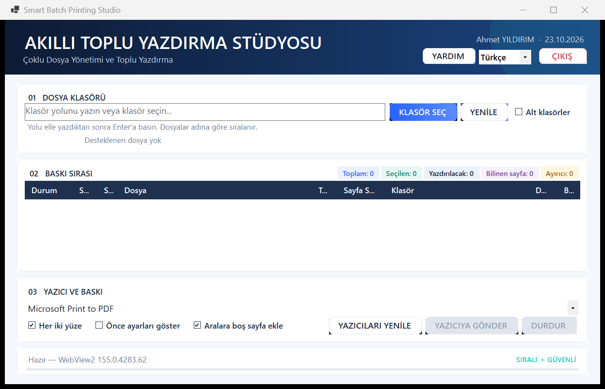

<div align="center">

# Smart Batch Printing Studio (SBPS)

**Windows için Çoklu Dosya Türü Destekli Toplu Yazdırma — Dosyaları Düzenleyin, Filtreleyin ve Tek Kuyrukta Yazdırın**

C# ve .NET 9 ile geliştirilmiş; desteklenen dosyaları tek tek açmadan düzenlemek ve Windows'ta yüklü bir yazıcıya sırayla göndermek için kullanılan masaüstü uygulaması.

[**English**](README.md) · [**Kurulum**](docs/INSTALLATION.md) · [**Kullanım Kılavuzu**](docs/USER_GUIDE.md) · [**Sorun Giderme**](docs/TROUBLESHOOTING.md)



</div>

## Genel Bakış

**Smart Batch Printing Studio (SBPS)**; **C#, .NET 9, Windows Forms ve Microsoft Edge WebView2** teknolojileriyle geliştirilmiş, Windows üzerinde çalışan bir **toplu dosya yazdırma (batch printing)** uygulamasıdır. PDF, görsel, metin ve web belgesi türlerinin bir arada bulunduğu yerel bir klasörden yazdırma kuyruğu oluşturmayı ve bu kuyruğu işlemeyi kolaylaştırır.

Belgeleri tek tek açmak yerine klasör seçebilir, klasörde bulunan dosya türlerine göre filtreleme yapabilir, dosyaları tek tek kuyruğa dahil edebilir veya kuyruktan çıkarabilir, yüklü bir Windows yazıcısı seçebilir, güvenli biçimde belirlenebilen sayfa sayısı bilgilerini inceleyebilir ve dosyaları **dosya adı sırasıyla** yazdırmaya gönderebilirsiniz.

SBPS, her kaynak dosyayı **ayrı bir yazdırma işi** olarak ele alır. Ayrıca ardışık dosyalar arasında isteğe bağlı boş ayırıcı sayfa, yazıcı ayarları, yazıcı tarafından destekleniyorsa çift taraflı yazdırma, işlem iptali ve dosya bazında tanılama durumu özelliklerini sunar.

Proje, **farklı dosya türlerini toplu yazdırma**, **klasör bazlı yazdırma**, **birden çok dosyayı sırayla yazdırma** ve **yazdırma kuyruğu yönetimi** ihtiyacı olan Windows kullanıcılarına yöneliktir. PDF, desteklenen dosya türlerinden yalnızca biridir. Gerçek yazdırma yetenekleri Windows'a, seçilen yazıcıya ve yazıcı sürücüsüne bağlıdır.

## Temel Özellikler

- Klasör yolunu elle girme, Windows klasör seçim penceresini kullanma veya bir klasörü pencereye sürükleyip bırakma; isteğe bağlı alt klasör taraması
- Listelenen desteklenen dosya sayısını ve kapsam dışı bırakılan desteklenmeyen dosya sayısını durum satırında görme
- Seçilen klasördeki dosya türlerinden otomatik oluşturulan dinamik filtrelerle kuyruğu filtreleme
- Dosya bazında seçim yaparak her dosyayı yazdırma kuyruğuna dahil etme veya kuyruktan çıkarma
- Toplam, seçili ve yazdırılabilir dosya sayılarını anlık takip etme
- Yazdırma işi başlatmadan, mümkün olduğunda dosya bazında sayfa sayısını görme
- Bilinen içerik sayfası toplamlarını ve planlanan ayırıcı sayfa toplamlarını inceleme
- Yüklü Windows yazıcılarından seçim yapma ve yazıcı listesini yenileme
- Yazıcının desteklemesi koşuluyla çift taraflı (duplex) yazdırma; varsayılan olarak açık
- Yazdırma öncesinde isteğe bağlı Windows yazıcı ayarları penceresini açma
- Ardışık dosyalar arasına isteğe bağlı boş ayırıcı sayfa ekleme; varsayılan olarak açık
- Dosyaları dosya adı sırasıyla yazdırmaya gönderme; işlemi iptal edebilme, dosya bazında durum ve tanılama günlüğü
- **Hatalı dosyaları atla (Skip failed files)** açıkken (varsayılan) başarısız dosyadan sonra kalan dosyalarla devam etme; kapatıldığında kalan dosyaları göndermeme
- İsteğe bağlı Türkçe ve İngilizce ipuçları; **Tips** açılana kadar ipuçları gizli kalır
- Windows bölge ayarlarından başlangıçta belirlenen, çalışma sırasında değiştirilebilen Türkçe ve İngilizce arayüz
- Yüksek DPI uyumlu Windows Forms arayüzü ve bölümlere ayrılmış uygulama içi yardım penceresi
- Ekrandaki **Exit** düğmesiyle çıkış; etkin yazdırma işlemi sırasında kapatma için onay isteme

## Desteklenen Dosya Biçimleri

SBPS'nin mevcut yazdırma akışında aşağıdaki dosya uzantıları desteklenir:

| Kategori | Uzantılar | Sayfa sayısı gösterimi |
|---|---|---|
| PDF belgeleri | `.pdf` | Belgeden güvenli biçimde belirlenebiliyorsa okunur; aksi durumda kullanılamaz |
| Görseller | `.jpg`, `.jpeg`, `.jfif`, `.png`, `.bmp`, `.gif`, `.webp`, `.svg`, `.avif`, `.ico`, `.jxl` | Mevcut yazdırma akışına uygun olarak 1 sayfa |
| Metin dosyaları | `.txt`, `.csv`, `.xml` | Yazdırma sırasında belirlenir |
| Web belgeleri | `.html`, `.htm`, `.xhtml`, `.mht`, `.mhtml` | Yazdırma sırasında belirlenir |

**Doğrudan desteklenmeyen biçimler:** Microsoft Word `.docx` ve Microsoft Excel `.xlsx`. Her uzantının her Windows/yazıcı yapılandırmasında sorunsuz yazdırılacağı varsayılmamalıdır.

## Başlangıç

### Sistem Gereksinimleri

- Windows 10 veya Windows 11
- Geliştirme için [.NET 9 SDK](https://dotnet.microsoft.com/download/dotnet/9.0)
- **.NET desktop development** iş yüküyle Visual Studio 2022 sürüm 17.12 veya üzeri ya da .NET CLI
- Microsoft Edge WebView2 Runtime
- Yazdırma için Windows'ta yüklü en az bir yazıcı

### Depoyu Klonlama, Derleme ve Çalıştırma

```powershell
git clone https://github.com/AhmetYILDIRIMuyum/smart-batch-printing-studio.git
cd smart-batch-printing-studio
dotnet restore .\SBPS.sln
dotnet build .\SBPS.sln -c Debug
dotnet run --project .\src\SBPS\SBPS.csproj
```

Release derlemesi için:

```powershell
dotnet build .\SBPS.sln -c Release
```

Geliştirme ve çalışma zamanı ayrıntıları için [Kurulum Kılavuzu](docs/INSTALLATION.md) dosyasına bakın.

## Dosyalar Toplu Olarak Nasıl Yazdırılır?

1. Klasör yolunu girin, bir klasör seçin veya klasörü SBPS penceresine sürükleyip bırakın.
2. İsterseniz alt klasörleri dahil edin, ardından dosya listesini yenileyin.
3. Dahil edilecek dosya türlerini seçin. PDF mevcutsa başlangıçta seçili gelir.
4. Dosya bazındaki onay kutularıyla yazdırma kuyruğunu düzenleyin.
5. Dosya bazında sayfa sayısı bilgilerini ve kuyruk istatistiklerini inceleyin.
6. Yüklü bir yazıcı seçin; çift taraflı yazdırma, ayırıcı sayfa ve gelişmiş ayar seçeneklerini kontrol edin.
7. **Send to Printer** düğmesini seçin ve onay penceresini onaylayın.
8. Uygulama içi kılavuz için **Help**, kapatmak için **Exit** düğmesini kullanın.

**Ayırıcı sayfa kuralı:** İlk dosyadan önce veya son dosyadan sonra boş ayırıcı sayfa eklenmez. *N* dosyalık bir kuyrukta en fazla *N − 1* ayırıcı sayfa oluşturulur.

Ayrıntılı adımlar için [Kullanım Kılavuzu](docs/USER_GUIDE.md) dosyasına bakın.

## Kullanılan Teknolojiler

| Teknoloji | Kullanım amacı |
|---|---|
| **C# / .NET 9** | Windows masaüstü uygulaması |
| **Windows Forms (WinForms)** | Kullanıcı arayüzü |
| **Microsoft Edge WebView2** | Belge görüntüleme ve yazdırma |
| **`System.Drawing.Printing`** | Windows yazdırma API'lerine erişim |
| **Windows Property System** | PDF sayfa sayısı için en iyi çabayla çalışan yedek yöntem |

Projedeki tek NuGet bağımlılığı **`Microsoft.Web.WebView2`** paketidir.

## Proje Yapısı

```text
SBPS.sln
src/
  SBPS/
    SBPS.csproj
    MainForm.cs
    FilePageCountService.cs
    PdfFileItem.cs
    Localization.cs
    HelpDialog.cs
    PremiumControls.cs
    Program.cs
    app.manifest
docs/
  ARCHITECTURE.md
  INSTALLATION.md
  USER_GUIDE.md
  TROUBLESHOOTING.md
```

Uygulama ayrıntıları için [Mimari](docs/ARCHITECTURE.md) belgesine bakın.

## Yapılandırma ve Uygulama Verileri

SBPS, yüklü yazıcıları Windows'tan okur. Yazıcı yetenekleri ve çift taraflı yazdırmanın son davranışı, seçilen yazıcı ve sürücüsü tarafından belirlenir.

Yazdırma tercihleri oturumlar arasında **kalıcı olarak saklanmaz**. Varsayılan seçenekler:

| Ayar | Başlangıç durumu |
|---|---|
| Boş ayırıcı sayfalar | Açık |
| Çift taraflı yazdırma | Açık; yazıcı desteğine bağlı |
| Hatalı dosyaları atla | Açık |
| Önce ayarları göster | Kapalı |
| İpuçları | Kapalı |

Son yüklenen klasör `%LocalAppData%\FilePrintStudio\last-folder.txt` dosyasında saklanır. Önceki kurulumlarla uyumluluğu korumak için tanılama günlükleri ve WebView2 önbelleği `%LocalAppData%\FilePrintStudio` konumunu kullanmaya devam eder.

## Derleme ve Geliştirme Notları

Çözümün hedef çerçevesi `net9.0-windows` olarak belirlenmiştir. `bin/`, `obj/`, `.vs/` ve `publish/` klasörlerindeki derleme çıktıları kaynak kontrolüne dahil edilmez.

Şu anda **otomatik test projesi bulunmamaktadır**. Değişiklikler Debug ve Release derlemeleriyle, ayrıca fiziksel yazdırma içermeyen başlatma ve arayüz kontrolleriyle doğrulanmalıdır. **Operatörün açık onayı olmadan fiziksel test sayfaları yazdırılmamalıdır.**

## Sorun Giderme

- **WebView2 başlatılamıyor:** Microsoft Edge WebView2 Evergreen Runtime'ı yükleyin veya onarın.
- **Yazıcı listede görünmüyor:** Windows yazıcı ayarlarını kontrol edin ve **Refresh Printers** seçeneğini kullanın.
- **PDF sayfa sayısı kullanılamıyor:** PDF şifreli, bozuk, alışılmadık biçimde kodlanmış veya güvenli inceleme sınırının üzerinde olabilir. Sayfa sayısı incelemesi ile gerçek yazdırma birbirinden ayrı işlemlerdir.
- **Yazdırma sırasında dosya hatası oluşuyor:** **Skip failed files** açıkken SBPS sorunlu dosyayı atlar ve devam eder. Bu seçeneği kapatırsanız kalan dosyalar gönderilmez. Her iki durumda da tanılama günlüğü oluşturulur.

Daha fazla bilgi için [Sorun Giderme](docs/TROUBLESHOOTING.md) belgesine bakın.

## Sınırlamalar

- Gösterilen sayfa sayısı, fiziksel kâğıt yaprağı sayısının **garantisi değildir**. Kopya sayısı, çift taraflı yazdırma, yazıcı sürücüsünün davranışı ve ayırıcı yazdırma işleri sonucu değiştirebilir.
- Metin ve HTML belgelerinin sayfalara bölünmesi; yazdırma motoruna, kâğıt ayarlarına, kenar boşluklarına ve yazıcıya bağlıdır. Bu sayılar yazdırma sırasında belirlenir.
- Sıkıştırılmış, şifreli, hatalı biçimlendirilmiş veya çok büyük bazı PDF belgelerinde sayfa sayısı gösterilemeyebilir.
- Ayrı yazdırma işleri kullanılması, her yazıcı sürücüsünün çift taraflı yazdırma sınırlarını veya boş ayırıcı sayfaları aynı şekilde işleyeceğini garanti etmez.
- Windows ve Microsoft Edge WebView2 Runtime gereklidir.
- SBPS, `.docx` veya `.xlsx` dosyalarını **doğrudan yazdırma desteği sunmaz**.

## Lisans ve Kullanım Hakları

**Kaynak kodun görüntülenebilir olması, projenin açık kaynak olduğu anlamına gelmez.** Kaynak kod herkese açık olarak görüntülenebilir; ancak önceden alınmış yazılı izin olmaksızın yazılımı **kullanma, kopyalama, değiştirme, yeniden dağıtma, alt lisanslama veya satma** izni verilmemektedir.

Yazılımı veya kaynak kodunu kullanmadan önce [LICENSE](LICENSE) dosyasının tamamını okuyun.

## Geliştirici

**Ahmet YILDIRIM [dede]**  
[GitHub Profili](https://github.com/AhmetYILDIRIMuyum) · [E-posta](mailto:ahmetyildirimuyum@gmail.com)

## Katkıda Bulunma

Herkese açık bir katkı politikası henüz oluşturulmamıştır. Katkı hazırlamadan önce bir issue açın veya geliştiriciyle iletişime geçin. Deponun herkese açık olması, kaynak kodu yeniden kullanma ya da katkıda bulunma hakkı vermez.

## Proje Durumu

**Aktif geliştirme aşamasında.** Değişiklikler yayımlandığında Debug ve Release derleme sonuçları belgelenir. Üretim ortamına hazır olma veya sürüm desteği garantisi verilmez.

---

**Projeyi bulun:** [GitHub'da Smart Batch Printing Studio (SBPS)](https://github.com/AhmetYILDIRIMuyum/smart-batch-printing-studio) — PDF, görsel, metin ve web belgeleri dahil farklı dosya türlerini toplu yazdırmaya yönelik Windows uygulaması.
